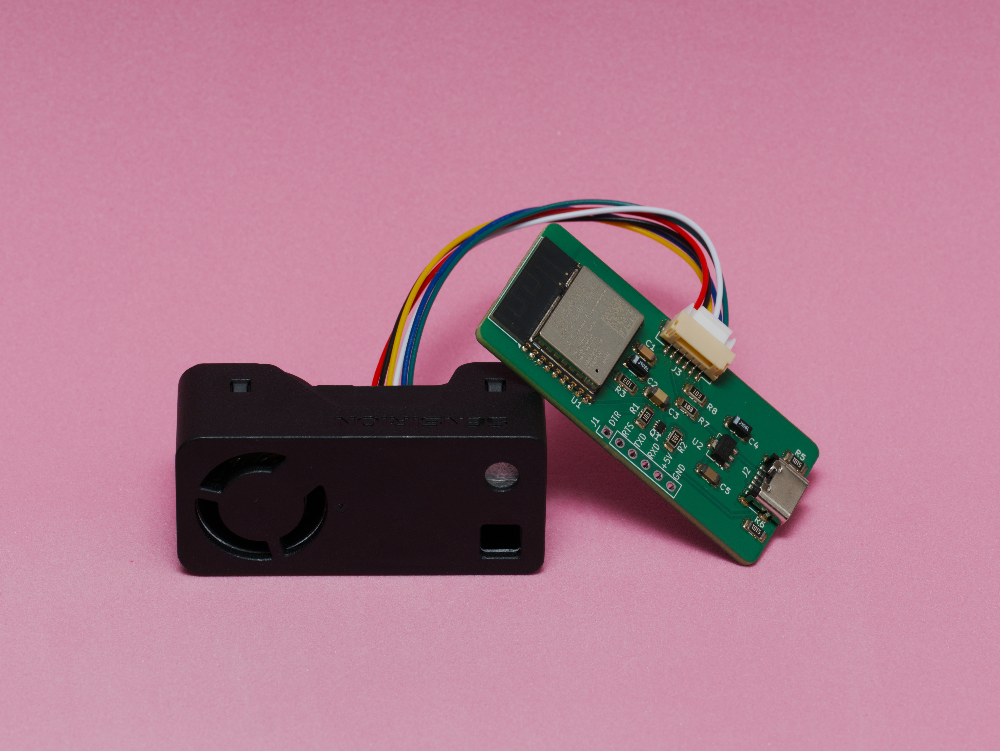

# Tendair

Tendair is a CO2 / Temp / RH / PM2.5 / VOC / NOx sensor hooked up to an ESP32.

It's basically just [this sensor](https://sensirion.com/media/documents/FAFC548D/693FBB15/PS_DS_SEN6x.pdf)
with [this micro controller](https://www.digikey.com/en/products/detail/espressif-systems/ESP32-C3-WROOM-02-H4/14553033)

Here is a photo:



This is basically just a new version of my [ESP8266 AQ sensor](https://github.com/tenderlove/esp8266aq).

I haven't made an enclosure yet, I'm working on that now.

## Flashing with ESPHome

`esphome.yml` configures the board for [ESPHome](https://esphome.io).
To use the ESP-IDF firmware instead, see [firmware/README.md](firmware/README.md).

Create `secrets.yaml` next to `esphome.yml` with the following keys:

```yaml
wifi_ssid: "your network"
wifi_password: "your wifi password"
api_encryption_key: "output of openssl rand -base64 32"
ap_password: "password for the fallback hotspot"
```

The USB-C port only supplies power, so the first flash goes through a
USB-serial adapter on the 6-pin header. Wire the adapter's TX to the board's
RXD and its RX to TXD, then run:

```
esphome -s name tendair-office run esphome.yml
```

The `-s name` flag sets the device's hostname, which defaults to `tendair`.
Pass the same name on every flash, or the board gets renamed. After the first
flash, `esphome run` can update the board over Wi-Fi.
